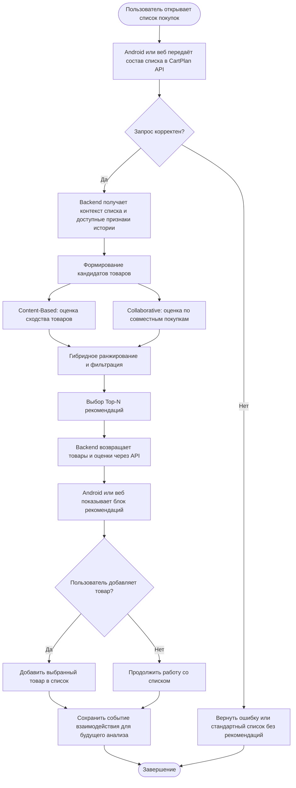

# CartPlan — место рекомендательной ML-модели в процессе

**Статус:** целевая схема проектируемой функциональности. Модель пока описана как проектируемая; схема не утверждает, что ML API уже внедрён.

## 1. BPMN-подобная схема процесса

## 2. Какую задачу решает модель

Модель помогает пользователю составить более полный список покупок. По уже добавленным товарам и доступной истории покупок она предлагает дополнительные товары, которые могут быть уместны в текущем контексте.

Результат модели — ранжированный список кандидатов, а не автоматическое изменение пользовательского списка.

## 3. Почему здесь целесообразно использовать ML

Правила вида «если добавлено молоко — предложить хлеб» быстро становятся громоздкими и плохо учитывают разнообразие покупательских привычек. ML позволяет выявлять закономерности в больших наборах покупок и учитывать:
- совместную встречаемость товаров в заказах;
- индивидуальные и общие паттерны повторных покупок;
- сходство товаров по доступным атрибутам и категориям.

Для MVP модель можно сравнить с простым baseline по популярности товаров. Использование ML оправдано, если оно даёт измеримое улучшение качества ранжирования.

## 4. Входные данные

- состав текущего списка покупок;
- идентификаторы товаров;
- категории и другие доступные атрибуты каталога;
- история покупок/взаимодействий пользователя, если она накоплена и доступна;
- агрегированные закономерности совместных покупок.

Для начального прототипа используется открытый датасет Instacart Market Basket Analysis. Он нужен для разработки и офлайн-оценки, но не заменяет реальные данные CartPlan в будущем.

## 5. Использование результата

Backend получает Top-N рекомендаций, сопоставляет идентификаторы товаров с каталогом CartPlan и передаёт данные клиенту. Android и веб отображают предложения. Пользователь самостоятельно выбирает, какие товары добавить. Факт показа, добавления или отклонения рекомендации может сохраняться как событие для последующего анализа и переобучения.

## 6. Границы ответственности

- ML-модель оценивает релевантность кандидатов.
- Backend проверяет запрос, получает данные, фильтрует результат и предоставляет API.
- Android и веб отображают рекомендации.
- Пользователь принимает окончательное решение.
- Проверка наличия товара и актуальной цены относится к каталогу/внешним сервисам, а не к рекомендательной модели.
