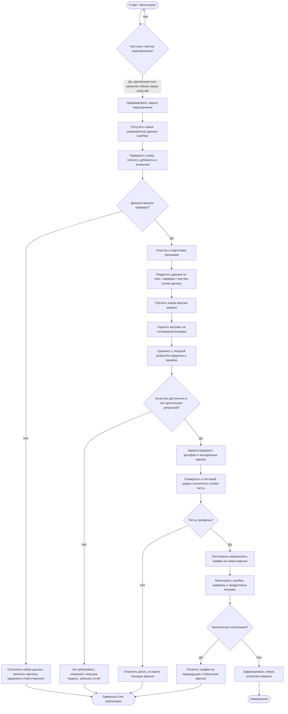

# CartPlan — процесс автоматического переобучения рекомендательной модели

**Статус:** проектируемый MLOps-процесс. Автоматический pipeline переобучения пока не заявляется как реализованный.

## 1. Схема процесса

## 2. Триггеры переобучения

Переобучение может запускаться по одному из двух основных триггеров:

1. **Плановый:** например, один раз в месяц. Периодичность уточняется после накопления достаточного объёма данных и оценки скорости изменения покупательских предпочтений.
2. **По объёму данных:** накоплено заранее установленное количество новых корректных событий покупок/взаимодействий с момента последнего обучения.

Дополнительный сигнал для внеплановой проверки — устойчивое ухудшение качества рекомендаций или заметное изменение распределения входных данных. Конкретные пороги устанавливаются после получения базовых метрик.

## 3. Этапы и передаваемые результаты

| Этап | Что происходит | Результат следующего этапа |
|---|---|---|
| 1. Триггер | Планировщик или счётчик новых событий инициирует pipeline | Задача переобучения |
| 2. Получение данных | Из хранилища выбираются новые разрешённые события и каталог | Исходный набор данных |
| 3. Контроль качества данных | Проверяются схема, пропуски, дубликаты, диапазоны и аномалии | Проверенный набор либо отчёт об ошибке |
| 4. Подготовка | Формируются признаки, кандидаты и обучающие примеры; исключается утечка будущих данных | Train/validation/test |
| 5. Обучение | Обучается кандидат новой версии гибридной модели | Артефакт кандидата |
| 6. Оценка | Рассчитываются Precision@K, Recall@K, MAP@K, NDCG@K и покрытие каталога | Отчёт о качестве |
| 7. Сравнение и решение | Кандидат сравнивается с текущей моделью и baseline | Решение: допустить или отклонить |
| 8. Регистрация | Сохраняются файл модели, версия, дата, параметры, состав данных и метрики | Версионированный артефакт |
| 9. Тестовый деплой | Кандидат запускается в тестовой среде; проверяются API, формат ответа, ошибки и задержка | Результат smoke-тестов |
| 10. Публикация | Новая версия постепенно получает трафик | Новая production-версия |
| 11. Мониторинг | Контролируются технические и продуктовые показатели | Подтверждение стабильности либо сигнал отката |

## 4. Условия допуска новой версии

Кандидат допускается к публикации, если одновременно выполняются условия:
- данные прошли проверки качества;
- расчёт метрик выполнен на отложенной выборке без утечки данных;
- ключевые метрики ранжирования не хуже текущей production-версии и достигают заранее установленного порога;
- нет критического ухудшения покрытия каталога или иных согласованных показателей;
- API и smoke-тесты проходят успешно.

Численные пороги нельзя назначать произвольно: их следует определить после оценки baseline и первой рабочей версии модели.

## 5. Действия при неуспешном прохождении проверок

- Если некорректны данные — набор отклоняется, причина фиксируется; текущая модель продолжает работать.
- Если качество кандидата хуже допустимого — кандидат не публикуется; сохраняется отчёт для анализа.
- Если не пройдены тесты после развёртывания — релиз отменяется.
- Если после постепенного переключения трафика выявлены критические ошибки или регрессии — выполняется откат на предыдущую стабильную версию.

Во всех случаях неудачное переобучение не должно останавливать рекомендации: система продолжает использовать последнюю стабильную production-версию.

## 6. Версионирование и воспроизводимость

Для каждой версии рекомендуется сохранять:
- уникальный номер версии и дату обучения;
- ссылку/идентификатор набора данных и период данных;
- параметры и конфигурацию обучения;
- метрики на validation/test;
- артефакт модели;
- статус версии (candidate, approved, production, rejected);
- сведения о предыдущей стабильной версии для отката.

## 7. Целевая архитектура

Переобучение выполняется серверным pipeline отдельно от пользовательского API рекомендаций. Обучение не должно блокировать текущую модель: новая версия сначала обучается и проверяется как кандидат, а переключение выполняется только после успешных проверок. Android и веб продолжают обращаться к единому серверному API.
